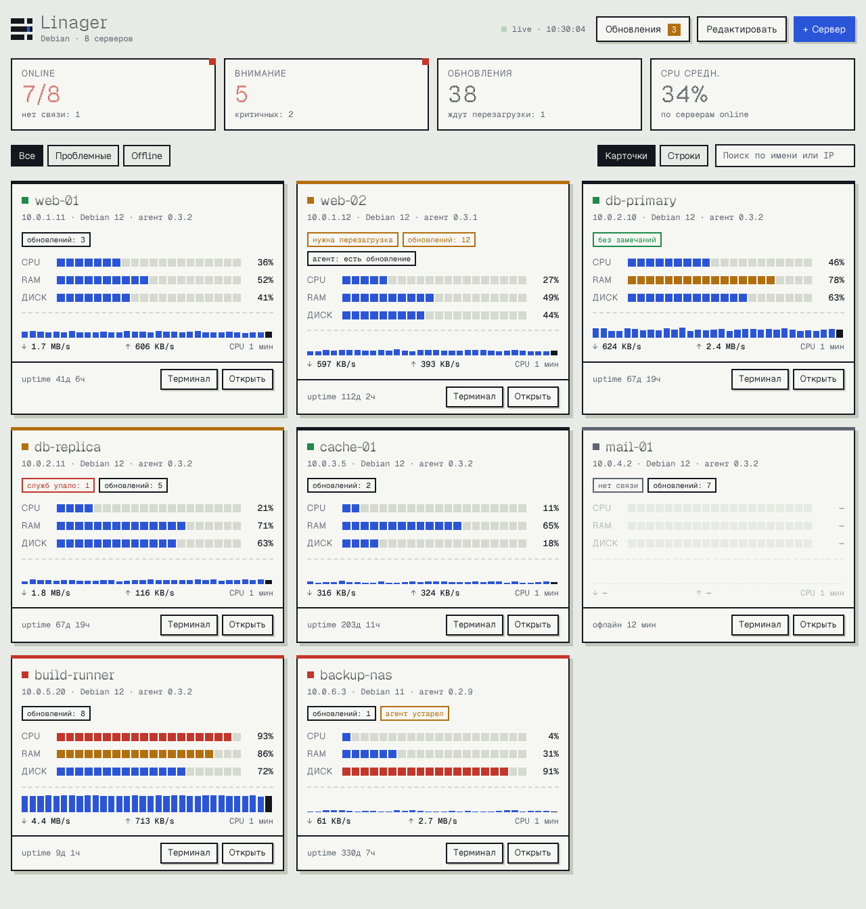

# Linager

**RU.** Открытая система управления серверами на Debian и Ubuntu: сервер с веб-админкой и лёгкие агенты на управляемых серверах. Метрики в реальном времени и история до 360 дней, веб-терминал, службы, обновления apt, файлы, сеть и файрвол с автоматическим откатом, Docker, подписанные обновления самой системы.

**EN.** Open-source server management for Debian and Ubuntu: a server with a web admin panel and lightweight agents on managed hosts. Live metrics and history up to 360 days, web terminal, services, apt updates, files, network and firewall with automatic rollback, Docker, signed self-updates.



## Установка / Install

```bash
curl -fsSL https://raw.githubusercontent.com/bolgov0zero/linager/main/install.sh | sh
```

Debian 12/13, Ubuntu 22.04/24.04/26.04, amd64, systemd. Подробно и безопасный вариант (скачать, проверить, запустить): [docs/ru/install.md](docs/ru/install.md) · [docs/en/install.md](docs/en/install.md).

## Документация / Documentation

| | RU | EN |
|---|---|---|
| Установка | [install](docs/ru/install.md) | [install](docs/en/install.md) |
| Обратный прокси (Caddy, nginx) | [proxy](docs/ru/proxy.md) | [proxy](docs/en/proxy.md) |
| Модули агента | [modules](docs/ru/modules.md) | [modules](docs/en/modules.md) |
| Обновления, бэкапы, откат | [updates](docs/ru/updates.md) | [updates](docs/en/updates.md) |
| Безопасность | [security](docs/ru/security.md) | [security](docs/en/security.md) |
| Архитектура | [architecture](docs/architecture.md) | [architecture](docs/en/architecture.md) |

Дизайн и макет интерфейса: [docs/design/](docs/design/).

## Разработка / Development

```bash
make web && make build      # frontend (Svelte 5 + Vite) and the linux/amd64 binary
make test                   # go vet + tests (set LINAGER_TEST_DSN for the PostgreSQL end-to-end tests)
cd web && npm run dev       # UI with hot reload, proxies /api to a local server on 127.0.0.1:18080 (see web/vite.config.ts)
```

Go, один бинарник `linager` (`server`, `agent`, `install`, `update`, `backup`), PostgreSQL, фронтенд встроен в бинарник (`go:embed`). Предложения и исправления приветствуются; об уязвимостях: [SECURITY.md](SECURITY.md).

## Лицензия / License

Apache-2.0, см. [LICENSE](LICENSE). Шрифты Medeo: SIL OFL 1.1 ([docs/design/mockup/fonts/](docs/design/mockup/fonts/)).
