<div align="center">


# Linager

**Open-source server management for Debian and Ubuntu.**
One web panel, a lightweight agent on every host: live metrics, terminal, files, services, apt, firewall, Docker and signed self-updates.

[](https://github.com/bolgov0zero/linager/releases/latest)
[](https://github.com/bolgov0zero/linager/actions/workflows/ci.yml)
[](LICENSE)
[](go.mod)


**English** · [Русский](README.ru.md)

[**Website**](https://bolgov0zero.github.io/linager/) · [Features](#features) · [Screenshots](#screenshots) · [Install](#install) · [How it works](#how-it-works) · [Documentation](#documentation)

<picture>
  <source media="(prefers-color-scheme: dark)" srcset="docs/screenshots/en/dashboard-dark.png">
  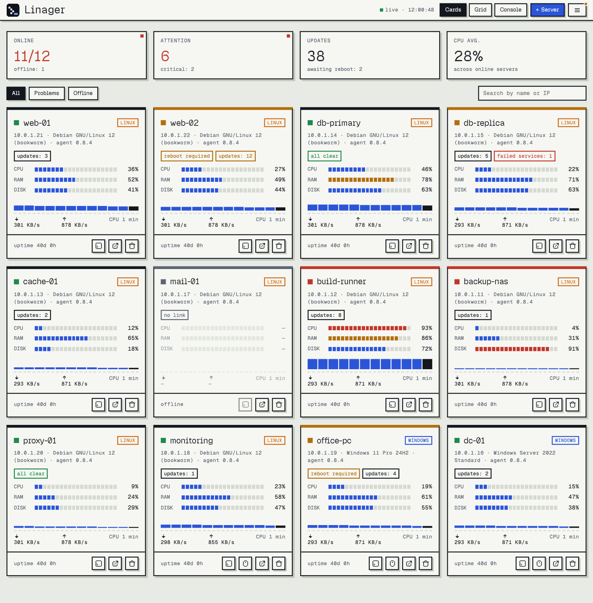
</picture>

</div>

## Why Linager

- **One binary, two roles.** `linager` is the server (admin panel + API) or the agent, picked at install time. No Docker, no Kubernetes, no cloud account. PostgreSQL runs locally next to the server.
- **Agents connect out.** The agent dials the server over mutual TLS, so managed hosts need no open inbound port. Every message is signed.
- **Safe by design.** Network and firewall edits are applied with a 30-second rollback timer that lives **on the agent**, so a bad rule that cuts the connection undoes itself. Dangerous actions ask for confirmation, and everything an administrator does lands in an audit log.
- **Small footprint.** Debian and Ubuntu (amd64), the agent also on arm64 (Raspberry Pi 4, 64-bit OS). The web interface is embedded in the binary.
- **Russian and English**, light and dark themes, a layout that works on a phone.

## Features

| | |
|---|---|
| **Dashboard** | Cards or a map of servers, groups, filters, search by name or IP. CPU, RAM, disk, network, uptime, pending apt updates, reboot needed, failed services at a glance. |
| **Metrics** | Live values every 5 seconds and history up to 360 days, charts for CPU, RAM, disk and network, events and reboots on the chart, CSV export, synchronized hover across charts. |
| **Terminal** | A web terminal on the host through the agent: floating windows, a key panel for phones, shared snippets, start the shell as another user. |
| **Files** | An explorer with a folder tree, multiple selection, copy, move, zip, `chmod` and `chown`, and an editor with syntax highlighting (CodeMirror 6). |
| **Updates (apt)** | Check and install everything or security updates only, per-package status and progress, console output on demand. A closed tab does not interrupt the installation. |
| **Services and processes** | systemd services (start, stop, restart, autostart), top processes, a live journal. |
| **Network and firewall** | Interfaces, DNS, routes (ifupdown; netplan is view-only) and nftables with address lists, a port overview and a log. Edits pile up in a draft and are applied with an automatic 30-second rollback. |
| **Security** | SSH overview for 7 days, password-guessing attempts, `authorized_keys` audit, fail2ban install and management, ending remote sessions, local accounts of a host. |
| **Docker** | Containers, images, logs, start and stop, "check for newer images", update an image or a whole compose project with a rollback. |
| **Disk** | Partitions, a fill-up forecast, what takes the space, safe cleanup (journal, apt cache, unused images, old kernels). |
| **Roles and sign-in** | Administrator, operator (chosen servers and modules) and auditor (read-only). Password with 2FA (TOTP, recovery codes) or a passkey. |
| **Admin access control** | A white or black list by real client address, trusted reverse proxies, an access journal. **New in 0.1.69.** |
| **Adding servers** | Three ways: confirm a key shown by the installer, an **install link** (one command on the new host, the signed release comes from your server, one click or none to approve), or an **install over SSH** from the panel (checks, stages, output, rollback on failure). |
| **Self-update** | Signed releases (minisign), a database backup before the update, automatic rollback, staged rollout to agents. |

Details per module: [docs/en/modules.md](docs/en/modules.md). History of changes: [CHANGELOG.md](CHANGELOG.md).

## Screenshots

The screenshots use demo data: fictional servers and documentation addresses.

### Server page and metrics

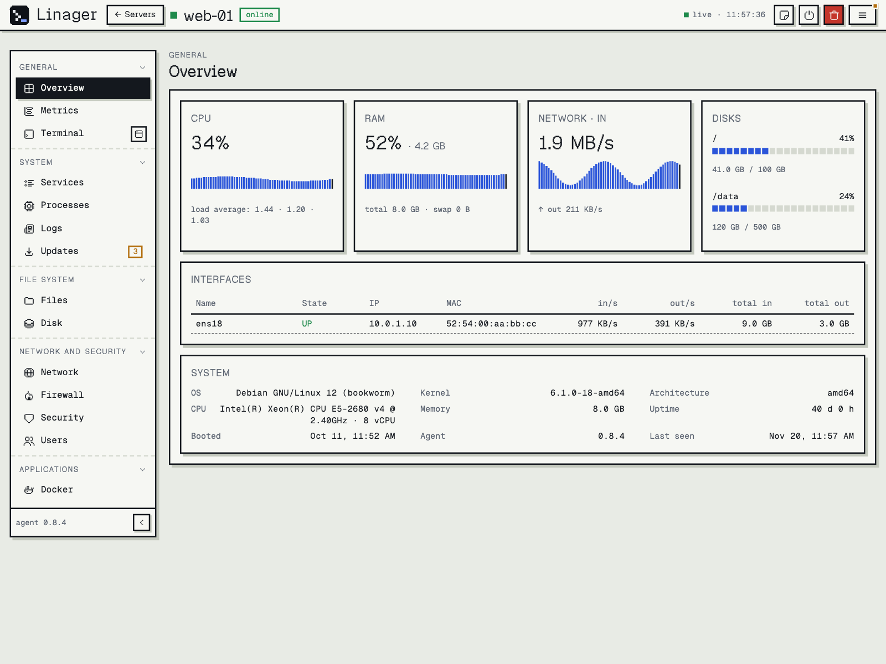

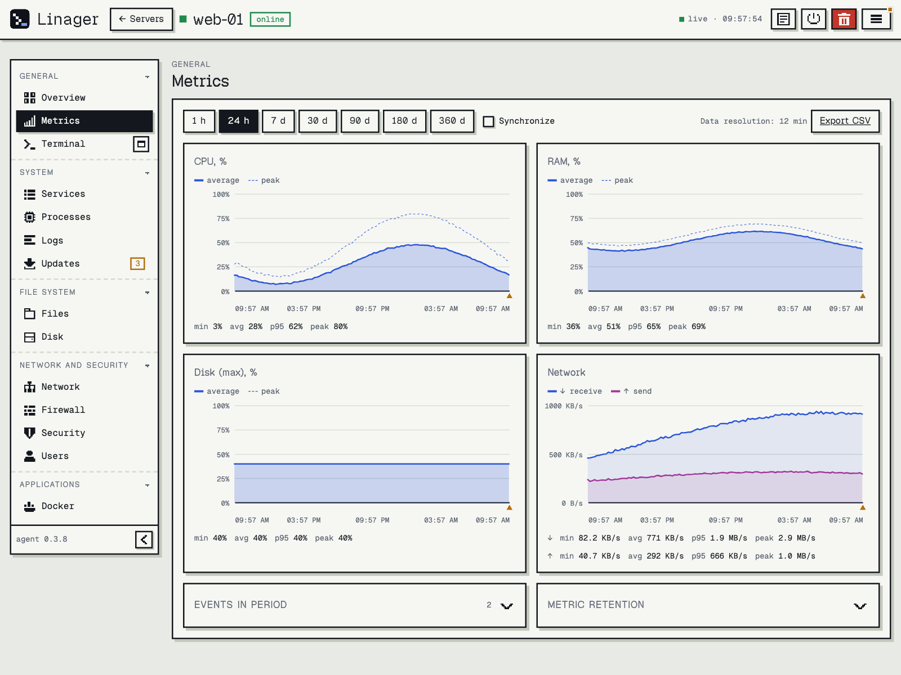

### Terminal, files, updates

<table>
<tr>
<td width="50%">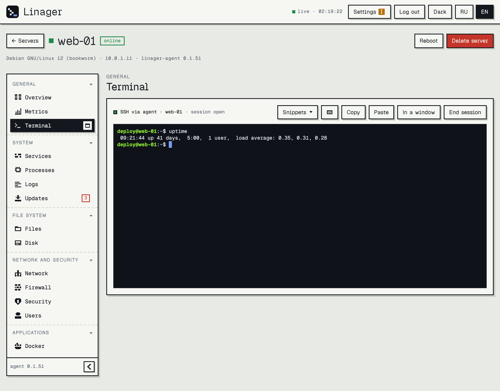<br><sub><b>Terminal.</b> Snippets, key panel, floating windows.</sub></td>
<td width="50%">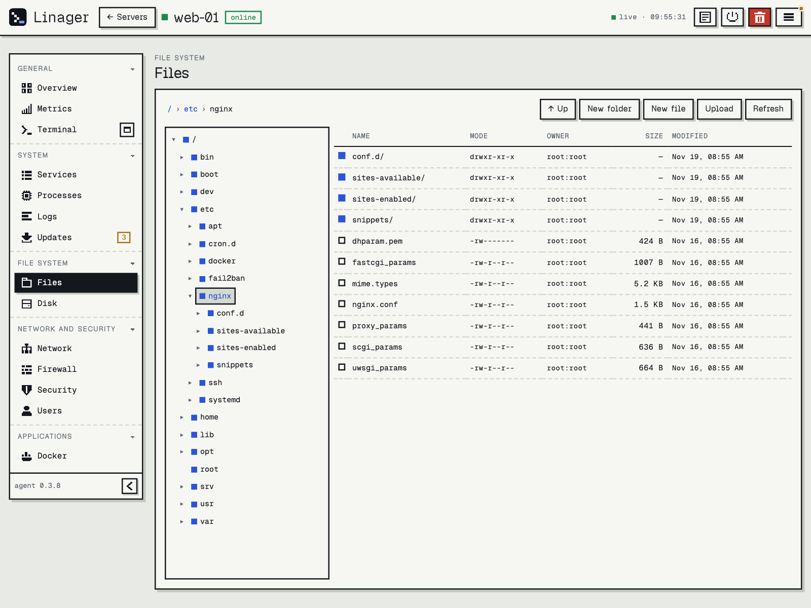<br><sub><b>Files.</b> Explorer and an editor with syntax highlighting.</sub></td>
</tr>
<tr>
<td width="50%">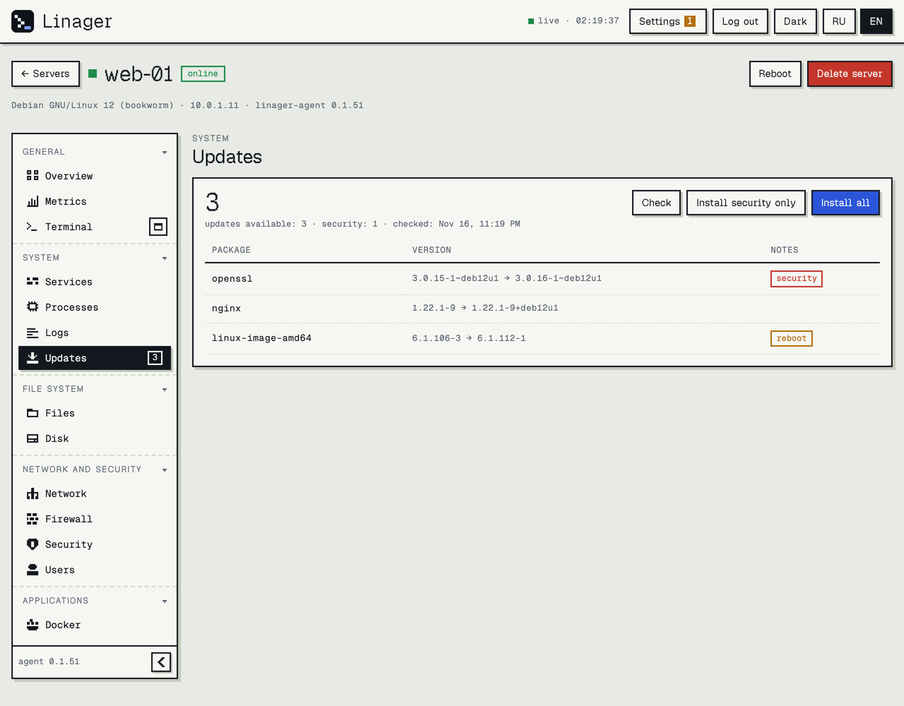<br><sub><b>Updates.</b> Per-package status and overall progress.</sub></td>
<td width="50%">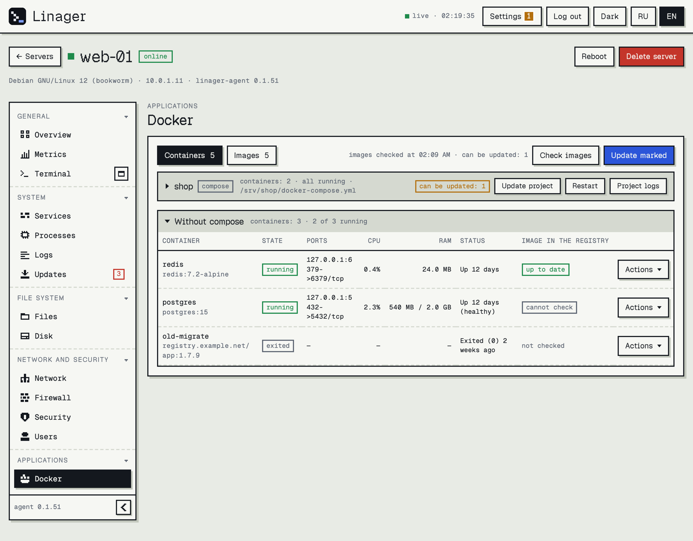<br><sub><b>Docker.</b> Containers, images, compose projects, image updates.</sub></td>
</tr>
</table>

### Firewall, security, accounts

<table>
<tr>
<td width="50%">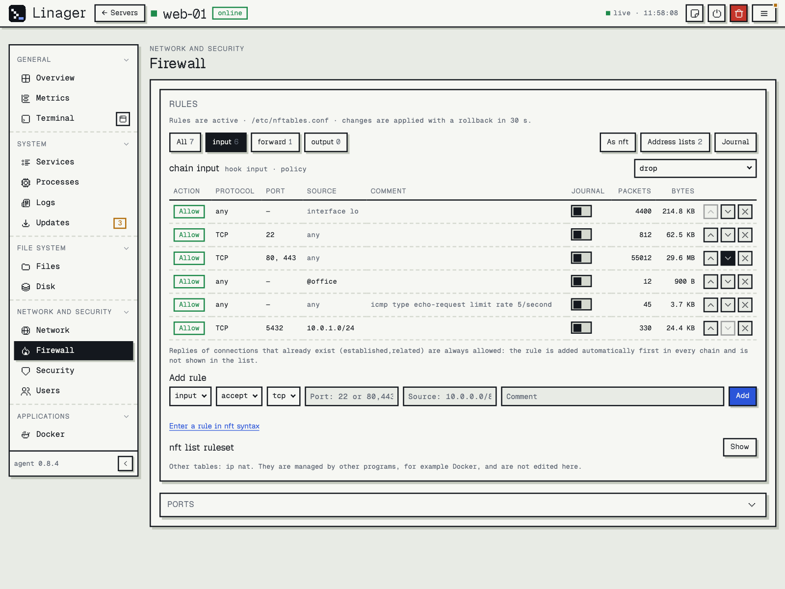<br><sub><b>Firewall.</b> A draft, then apply with a 30-second rollback on the agent.</sub></td>
<td width="50%">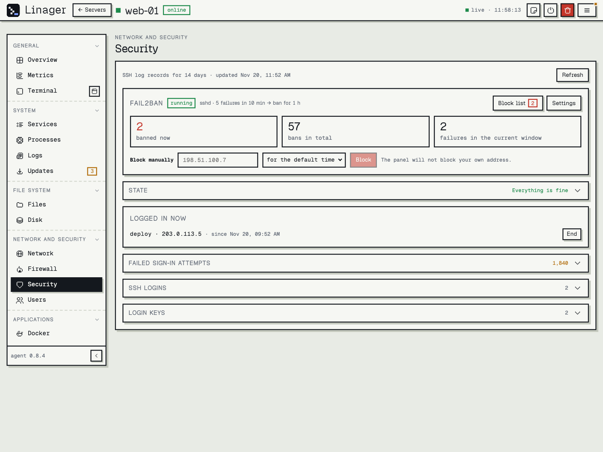<br><sub><b>Security.</b> SSH overview, fail2ban, keys, sessions.</sub></td>
</tr>
<tr>
<td width="50%">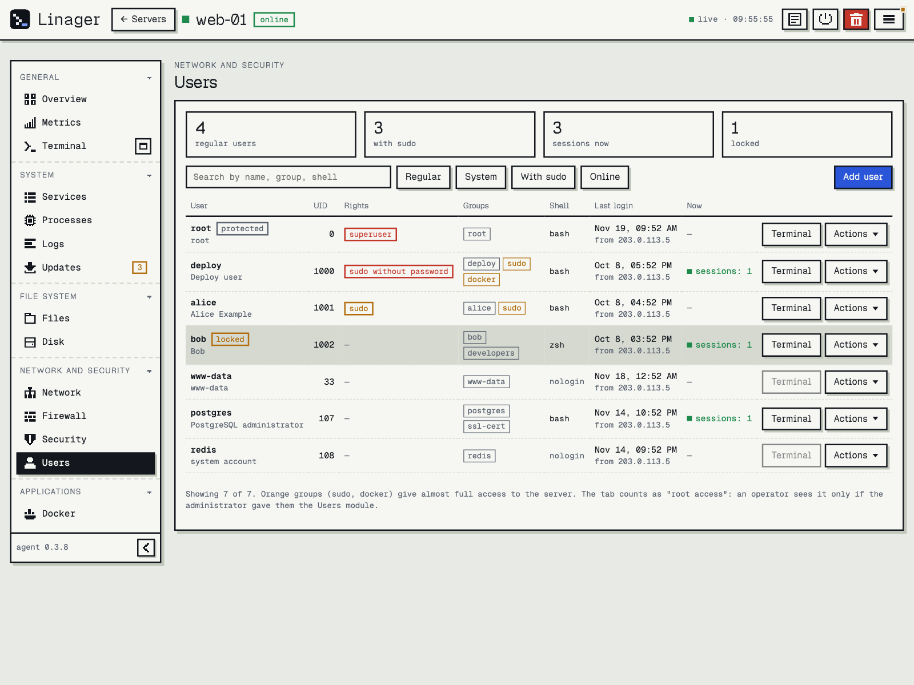<br><sub><b>Users.</b> Local accounts of a host with a terminal as the user.</sub></td>
<td width="50%">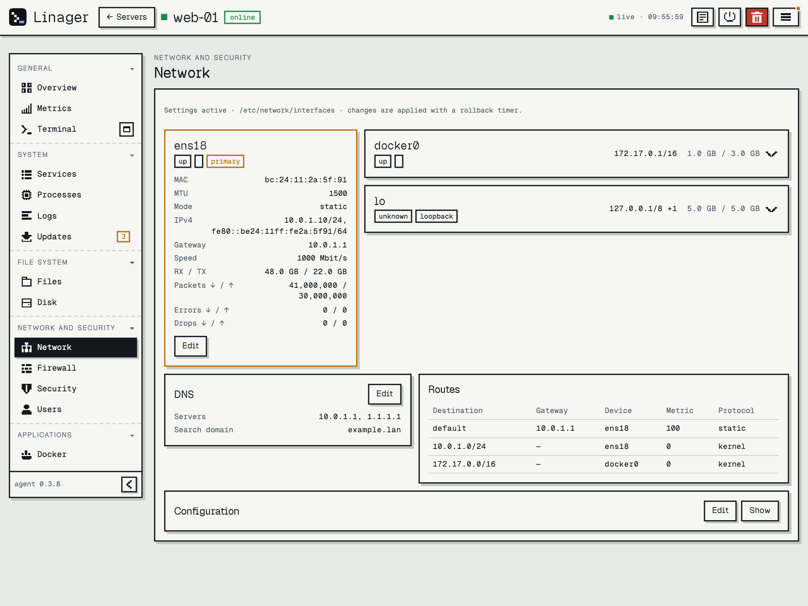<br><sub><b>Network.</b> Interfaces, DNS, routes; changes roll back on their own.</sub></td>
</tr>
</table>

### Admin panel access <sup>new in 0.1.69</sup>

Open the panel only to the networks you use. Pick a **white list** (whatever is not listed is refused) or a **black list** (whatever is not listed is allowed). Behind a reverse proxy such as Nginx Proxy Manager, add the proxy to **trusted proxies**: the real visitor address then comes from `X-Forwarded-For`, and only from those proxies, so it cannot be forged. Clients on the local network can still connect directly. The panel refuses any setting that would lock you out.


The access journal records page opens, sign-ins and refused requests with the client address and the proxy it came through. One click puts an address into the list.

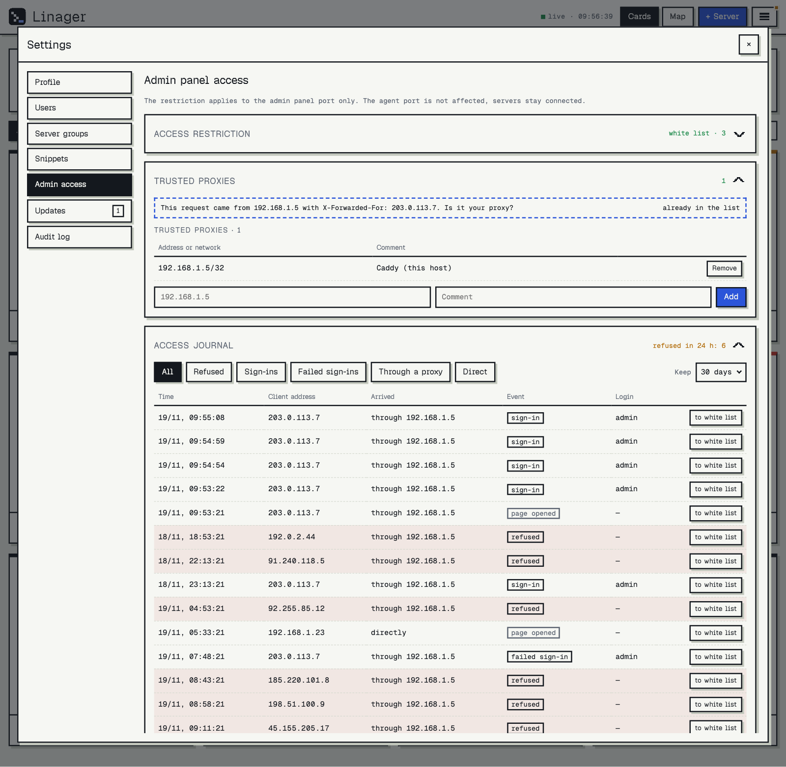

Locked yourself out anyway? Run `sudo linager access reset` on the server: the restriction goes off, the lists stay.

### On a phone

<table>
<tr>
<td width="50%" align="center">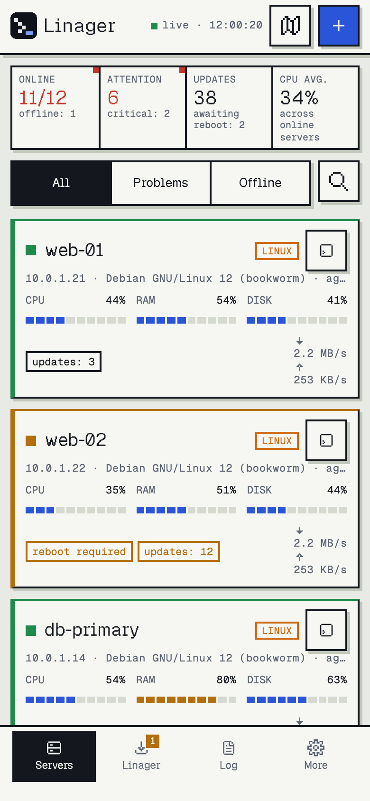</td>
<td width="50%" align="center">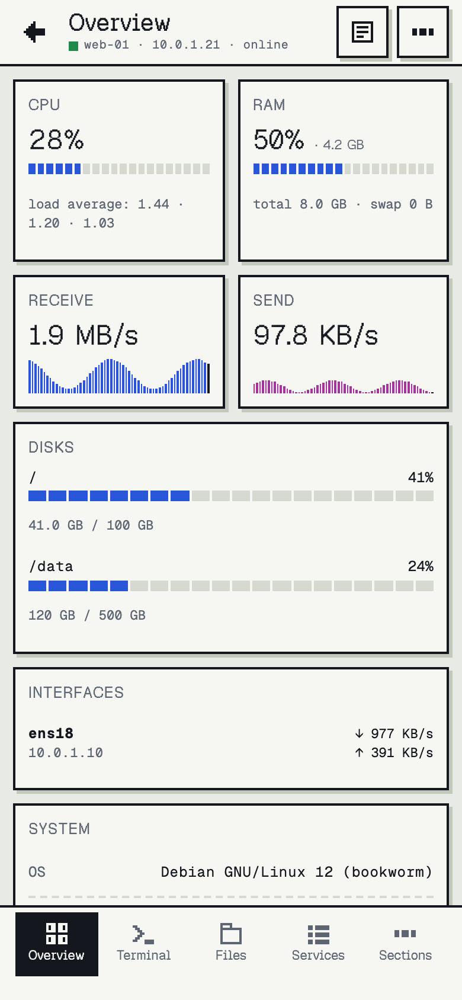</td>
</tr>
</table>

## Install

On a clean Debian or Ubuntu server, as root:

```bash
curl -fsSL https://raw.githubusercontent.com/bolgov0zero/linager/main/install.sh | sh
```

The wizard asks **Server** or **Client**, then sets up PostgreSQL, the keys, the administrator account and a systemd service. When it ends, the **Linager menu** opens (press Enter): the state of the host and numbered actions, the same as typing `linager` ([docs/en/menu.md](docs/en/menu.md)). Prefer to look first? Download, verify and run it yourself: [docs/en/install.md](docs/en/install.md).

**Add a managed host** ("+ Server" in the panel), three ways:

- **Confirm a key.** Run the same command on the host, pick **Client**, enter the server address. The agent shows a key and a check code; confirm it in the panel and the agent receives its certificate.
- **Install by a link.** The panel makes a link (lifetime, number of servers, optional networks and group) and shows a command for the new host, as root, with no `sudo` and no `curl` needed:

  ```bash
  wget -nv -O- --no-check-certificate --pinnedpubkey 'sha256//…' 'https://panel.example.com:9443/v1/join/lk_…' | sh
  ```

  The agent comes from the cached, signed release of **your server** (no GitHub), the key of the server is pinned in the command, and the host appears in the panel for one click, or at once when the link approves itself. The name is taken from the agent.
- **Install over SSH.** Enter the address, login and password (or a key) of the new host: the panel shows its host key, checks the system, the rights (asks for the `sudo` password when needed) and whether the host can reach the server, installs the agent, shows the stages and the output, and rolls the host back if the agent does not connect. Passwords live only in memory.

After either install the Linager menu opens on the new host. Details and the security notes: [docs/en/install.md](docs/en/install.md).

| | Server | Agent |
|---|---|---|
| Debian 12, 13 · Ubuntu 22.04, 24.04, 26.04 | amd64 | amd64, arm64 |
| Init system | systemd | systemd |

The panel can run behind Caddy (Let's Encrypt is set up by the installer) or behind your own reverse proxy: [docs/en/proxy.md](docs/en/proxy.md) has examples for nginx, Caddy and Nginx Proxy Manager.

## How it works

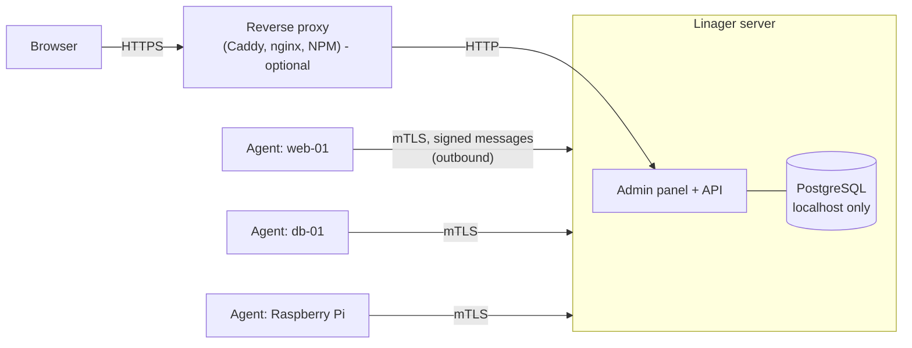

- The **server** keeps the data in a local PostgreSQL and serves the panel. The client port (default `9443`) is for agents only and does not go through the proxy.
- The **agent** opens an outgoing WSS connection with a certificate issued at pairing, pins the server fingerprint and reconnects by itself. Modules (terminal, files, network and others) can be switched off in `/etc/linager/agent.yaml`.
- Pairing shows a short check code on both sides, so a man-in-the-middle cannot slip in.

## Security

- mTLS between the server and agents; signed messages; the server fingerprint is pinned by the agent.
- Passwords hashed with Argon2id, optional mandatory 2FA, passkeys, recovery codes, login rate limits.
- Dangerous actions need an explicit confirmation on the server; the agent refuses them without it.
- Network and firewall changes roll back on their own unless you confirm them within 30 seconds.
- An audit log of every administrator action, with the connection address and the address from `X-Forwarded-For`.
- Releases are signed with minisign, the public key is embedded in the binary; a database copy is made before every update.
- Secrets have permissions 600; the service runs as an unprivileged user with systemd sandboxing.

Details and known limits: [docs/en/security.md](docs/en/security.md). To report a vulnerability, see [SECURITY.md](SECURITY.md).

## Documentation

| Topic | English | Русский |
|---|---|---|
| Installation | [install](docs/en/install.md) | [установка](docs/ru/install.md) |
| Reverse proxy (Caddy, nginx, NPM) | [proxy](docs/en/proxy.md) | [прокси](docs/ru/proxy.md) |
| Admin panel access | [access](docs/en/access.md) | [доступ к админке](docs/ru/access.md) |
| Agent modules and configuration | [modules](docs/en/modules.md) | [модули](docs/ru/modules.md) |
| Updates, backups, rollback | [updates](docs/en/updates.md) | [обновления](docs/ru/updates.md) |
| Terminal menu (`linager`) | [menu](docs/en/menu.md) | [меню](docs/ru/menu.md) |
| Security | [security](docs/en/security.md) | [безопасность](docs/ru/security.md) |
| Architecture | [architecture](docs/en/architecture.md) | [архитектура](docs/architecture.md) |

The documentation is also published as a site: <https://bolgov0zero.github.io/linager/>. The interface design and mockups are in [docs/design/](docs/design/).

## Development

```bash
make web && make build      # frontend (Svelte 5 + Vite) and the linux/amd64 and linux/arm64 binaries
make test                   # go vet + tests (set LINAGER_TEST_DSN for the PostgreSQL end-to-end tests)
cd web && npm run dev       # UI with hot reload, proxies /api to a local server on 127.0.0.1:18080
```

Go, a single `linager` binary (`server`, `agent`, `install`, `update`, `backup`, `restore`, `access`), PostgreSQL, the frontend embedded with `go:embed`. Issues and pull requests are welcome.

## License

[Apache-2.0](LICENSE). The Medeo fonts are under SIL OFL 1.1 ([docs/design/mockup/fonts/](docs/design/mockup/fonts/)).
