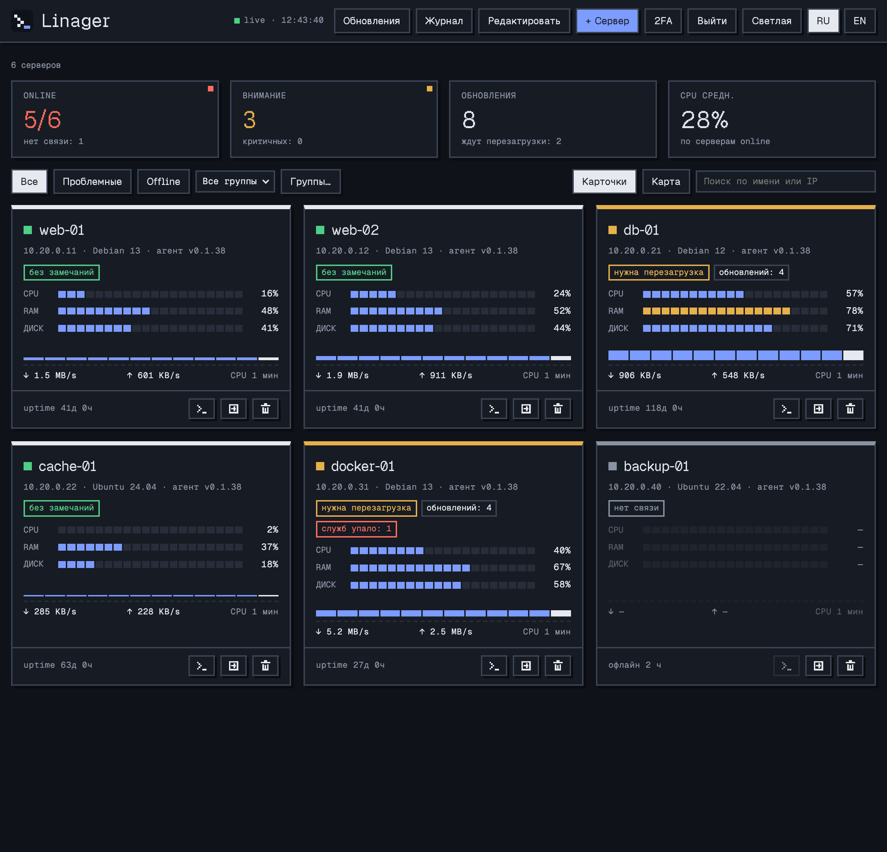
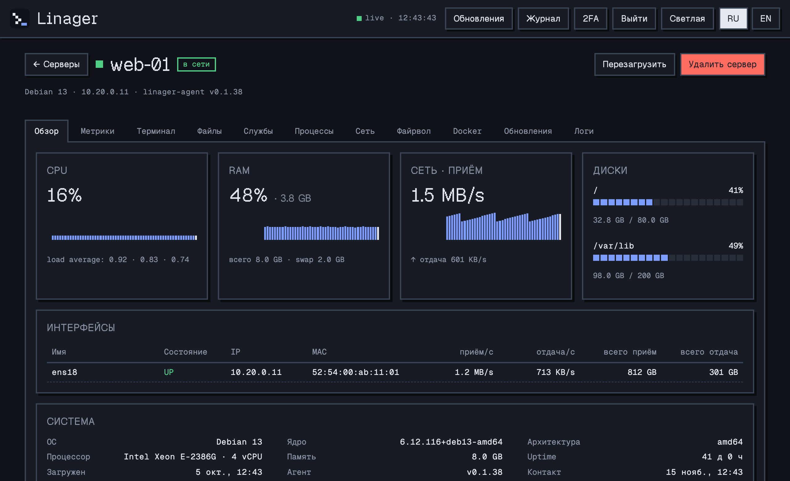
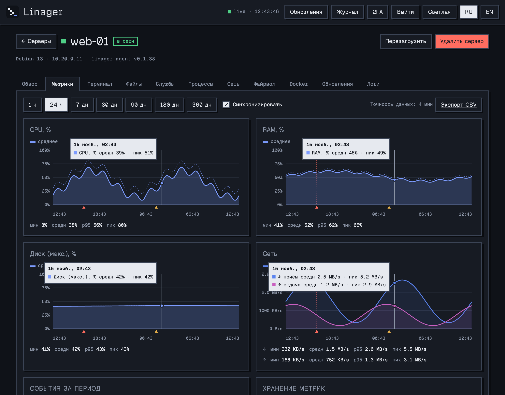
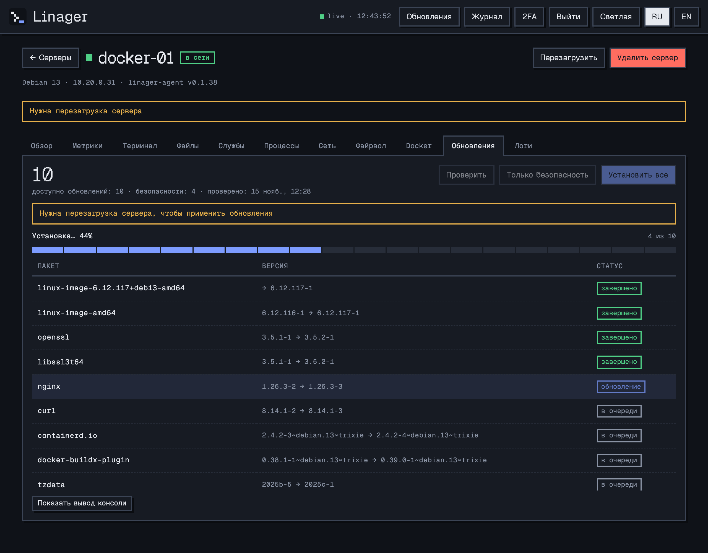
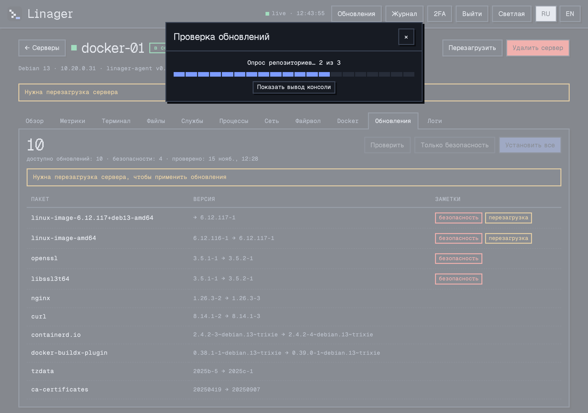
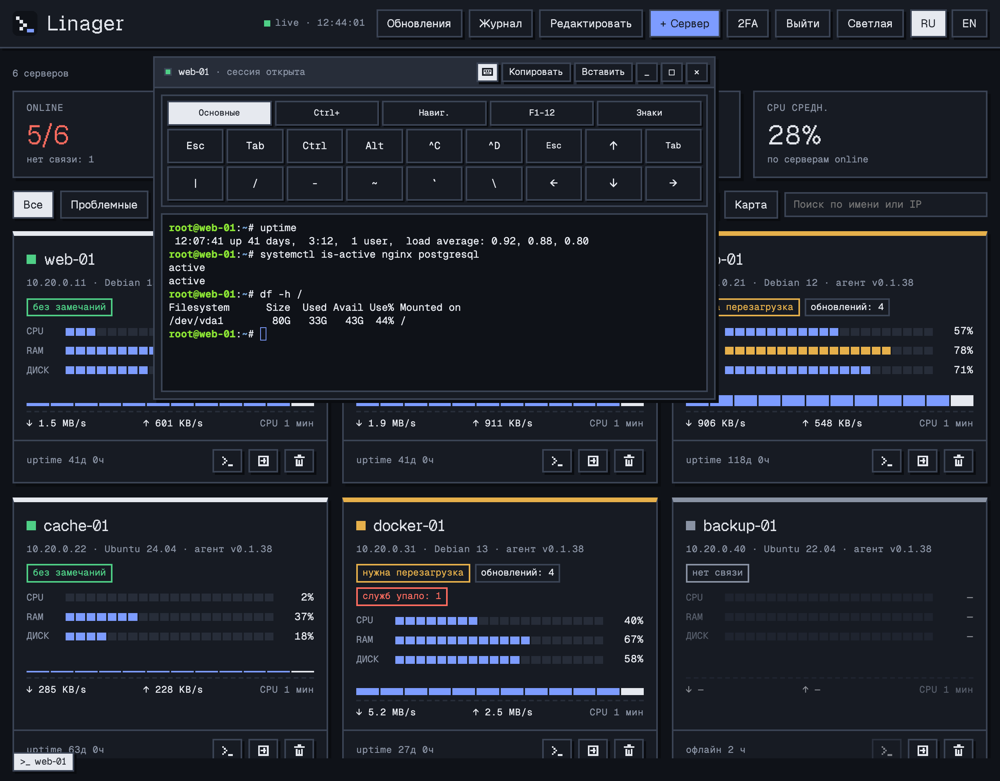

# Linager

**RU.** Открытая система управления серверами на Debian и Ubuntu: сервер с веб-админкой и лёгкие агенты на управляемых серверах. Метрики в реальном времени и история до 360 дней, веб-терминал, службы, обновления apt, файлы, сеть и файрвол с автоматическим откатом, Docker, подписанные обновления самой системы.

**EN.** Open-source server management for Debian and Ubuntu: a server with a web admin panel and lightweight agents on managed hosts. Live metrics and history up to 360 days, web terminal, services, apt updates, files, network and firewall with automatic rollback, Docker, signed self-updates.



## Возможности / Features

| | RU | EN |
|---|---|---|
| **Дашборд / Dashboard** | Карточки или карта серверов, группы, фильтры и поиск по имени или IP. На карточке: CPU, RAM, диск, сеть, uptime, число обновлений apt (так же, как на вкладке сервера), нужна ли перезагрузка, упавшие службы. | Cards or a map of servers, groups, filters and search by name or IP. A card shows CPU, RAM, disk, network, uptime, the number of apt updates (counted the same way as on the server tab), whether a reboot is needed, failed services. |
| **Метрики / Metrics** | Реальное время и история до 360 дней (точность от 5 секунд до часа), графики CPU, RAM, диска и сети, события и перезагрузки на графике, экспорт CSV. Флажок «Синхронизировать» показывает выделение и подсказку сразу на всех графиках. | Live values and history up to 360 days (resolution from 5 seconds to an hour), CPU, RAM, disk and network charts, events and reboots on the chart, CSV export. The "Synchronize" checkbox shows the hover highlight and tooltip on all charts at once. |
| **Терминал / Terminal** | Веб-терминал на сервере через агента. Плавающие окна (несколько сразу, можно свернуть), панель клавиш для телефона (Esc, Tab, Ctrl, стрелки, F1-F12 и другие), сниппеты: общий список команд, из выпадающего списка команду можно вставить и выполнить или только вставить. | A web terminal on the server through the agent. Floating windows (several at once, minimizable), a key panel for phones (Esc, Tab, Ctrl, arrows, F1-F12 and more), snippets: a shared list of commands, pasted and run or only pasted from a drop-down. |
| **Файлы / Files** | Проводник: дерево папок, контекстное меню, выбор нескольких файлов, копирование, перенос, zip, свойства с chmod и chown. Редактор (CodeMirror 6) с подсветкой синтаксиса в плавающих окнах. | An explorer: folder tree, context menu, multiple selection, copy, move, zip, properties with chmod and chown. An editor (CodeMirror 6) with syntax highlighting in floating windows. |
| **Обновления apt / apt updates** | Проверка и установка всего или только обновлений безопасности. У каждого пакета свой статус (в очереди, обновление, завершено, ошибка), общий прогресс, вывод консоли по кнопке. Закрытая вкладка не прерывает установку, статусы вернутся при открытии. | Check and install everything or security updates only. Every package has its own status (queued, updating, done, error), an overall progress bar, console output on demand. A closed tab does not interrupt the installation, the statuses come back when you reopen it. |
| **Безопасность / Security** | Вкладка с обзором SSH за 7 дней, только чтение: состояние `sshd` (вход root, пароли), попытки подбора по адресам и логинам, входы с пометкой «до этого подбирали пароль», fail2ban, ключи в `authorized_keys` с отпечатками и пометкой слабых, сессии сейчас. | A tab with a 7-day SSH overview, read-only: the `sshd` state (root login, passwords), guessing attempts by address and login, logins flagged "guessed passwords before", fail2ban, `authorized_keys` with fingerprints and weak ones marked, current sessions. |
| **Службы, процессы, журналы / Services, processes, logs** | Службы systemd (запуск, остановка, автозапуск, игнорирование упавших), топ процессов, журнал в реальном времени. | systemd services (start, stop, autostart, ignoring failed ones), top processes, a live journal. |
| **Сеть и файрвол / Network and firewall** | Интерфейсы, DNS, маршруты, правка конфигурации (ifupdown и netplan), nftables. Правки копятся в черновике и применяются с подтверждением в течение 30 секунд, иначе агент откатывает их сам. | Interfaces, DNS, routes, configuration editing (ifupdown and netplan), nftables. Changes pile up in a draft and are applied with a 30-second confirmation, otherwise the agent rolls them back itself. |
| **Docker** | Контейнеры и образы, логи, запуск, остановка, перезапуск, удаление. «Обновить образ»: загрузка нового образа и пересоздание контейнера с откатом, для docker compose через `docker compose pull` и `up -d`. | Containers and images, logs, start, stop, restart, remove. "Update image": pull a new image and recreate the container with a rollback, through `docker compose pull` and `up -d` for docker compose. |
| **Обновления Linager / Linager updates** | Подписанные релизы (minisign), копия базы перед обновлением, откат, поэтапная раскатка по агентам. | Signed releases (minisign), a database backup before the update, rollback, staged rollout to agents. |
| **Безопасность / Security** | mTLS между сервером и агентами, подтверждение опасных действий, журнал аудита всех действий администратора. Вход: логин и пароль с 2FA (TOTP, коды восстановления) или кнопка Passkey без пароля. Несколько пользователей, смена пароля. | mTLS between the server and agents, confirmation of dangerous actions, an audit log of all administrator actions. Sign-in: login and password with 2FA (TOTP, recovery codes) or the Passkey button without a password. Several users, password change. |
| **Интерфейс / Interface** | Окно «Настройки» (профиль, пользователи, обновления, журнал, сниппеты), русский и английский, светлая и тёмная темы, телефоны (значок на домашнем экране, таблицы блоками). | A Settings window (profile, users, updates, audit log, snippets), Russian and English, light and dark themes, phones (a home screen icon, tables as blocks). |

Подробности по модулям: [docs/ru/modules.md](docs/ru/modules.md) · [docs/en/modules.md](docs/en/modules.md). История изменений: [CHANGELOG.md](CHANGELOG.md).

## Скриншоты / Screenshots

Скриншоты сняты на демонстрационных данных (вымышленные серверы и адреса). / The screenshots use demo data (fictional servers and addresses).

**Страница сервера / Server page**



**Метрики с синхронизацией графиков / Metrics with synchronized charts**



**Установка обновлений: статус каждого пакета и общий прогресс / Installing updates: a status for every package and overall progress**



**Проверка обновлений / Checking for updates**



**Плавающий терминал с панелью клавиш / A floating terminal with the key panel**



## Установка / Install

```bash
curl -fsSL https://raw.githubusercontent.com/bolgov0zero/linager/main/install.sh | sh
```

Debian 12/13, Ubuntu 22.04/24.04/26.04, amd64, systemd. Подробно и безопасный вариант (скачать, проверить, запустить): [docs/ru/install.md](docs/ru/install.md) · [docs/en/install.md](docs/en/install.md).

## Документация / Documentation

| | RU | EN |
|---|---|---|
| Установка | [install](docs/ru/install.md) | [install](docs/en/install.md) |
| Обратный прокси (Caddy, nginx) | [proxy](docs/ru/proxy.md) | [proxy](docs/en/proxy.md) |
| Модули агента | [modules](docs/ru/modules.md) | [modules](docs/en/modules.md) |
| Обновления, бэкапы, откат | [updates](docs/ru/updates.md) | [updates](docs/en/updates.md) |
| Безопасность | [security](docs/ru/security.md) | [security](docs/en/security.md) |
| Архитектура | [architecture](docs/architecture.md) | [architecture](docs/en/architecture.md) |

Дизайн и макет интерфейса: [docs/design/](docs/design/).

## Разработка / Development

```bash
make web && make build      # frontend (Svelte 5 + Vite) and the linux/amd64 binary
make test                   # go vet + tests (set LINAGER_TEST_DSN for the PostgreSQL end-to-end tests)
cd web && npm run dev       # UI with hot reload, proxies /api to a local server on 127.0.0.1:18080 (see web/vite.config.ts)
```

Go, один бинарник `linager` (`server`, `agent`, `install`, `update`, `backup`), PostgreSQL, фронтенд встроен в бинарник (`go:embed`). Предложения и исправления приветствуются; об уязвимостях: [SECURITY.md](SECURITY.md).

## Лицензия / License

Apache-2.0, см. [LICENSE](LICENSE). Шрифты Medeo: SIL OFL 1.1 ([docs/design/mockup/fonts/](docs/design/mockup/fonts/)).
