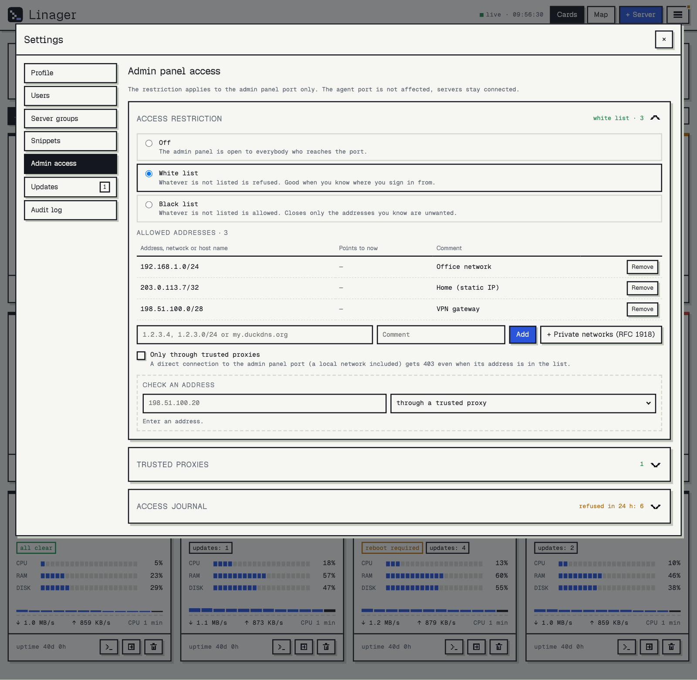
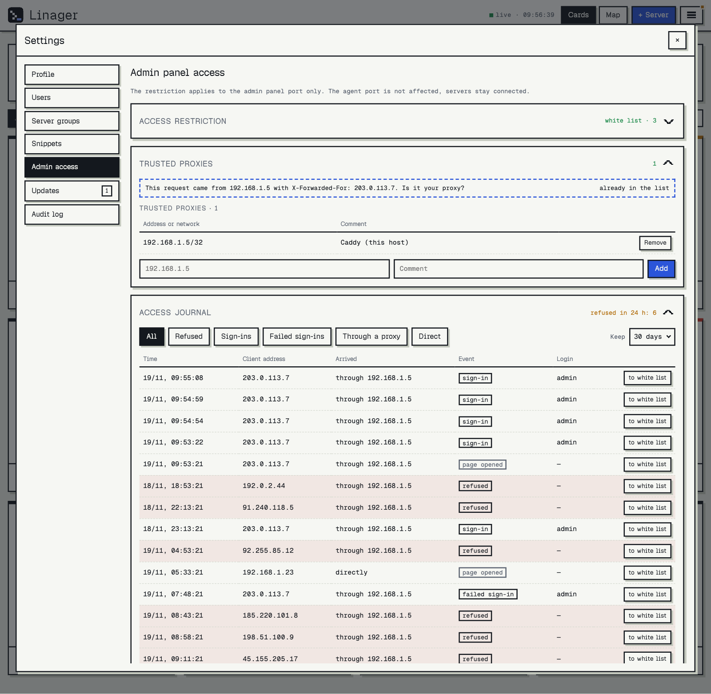

# Admin panel access

Settings → **Admin access** restricts who may open the admin panel and shows a journal of visits. The restriction applies to the admin panel port only; the agent port is not affected, so servers stay connected.



## Modes

| Mode | Behavior |
|---|---|
| Off | The panel is open to everybody who reaches the port. |
| White list | Whatever is not listed is refused. Good when you know where you sign in from. |
| Black list | Whatever is not listed is allowed. Closes only the addresses you know are unwanted. |

Each mode has its own list of addresses and networks (`203.0.113.7` or `203.0.113.0/24`, IPv6 too) with a comment. The button "+ Private networks (RFC 1918)" adds `10.0.0.0/8`, `172.16.0.0/12` and `192.168.0.0/16` to the white list. "Check an address" tells what the server would do with an address, through a trusted proxy or directly.

## Trusted proxies

Behind a reverse proxy such as Nginx Proxy Manager the connection arrives from the proxy, not from the visitor. The server reads the real address from `X-Forwarded-For` **only** when the connection comes from a trusted proxy. A connection from any other address is judged by its own address and the header is ignored, so the header cannot be forged and the local network can connect directly.

When you open the section through the proxy, it shows how the request arrived and offers "Add … as a trusted proxy". Add the proxy and remove the default `0.0.0.0/0` (everybody trusted): while everybody is trusted, the lists cannot be turned on.

::: warning Do not leave the proxy untrusted
If the proxy is not trusted and the white list holds your whole local network, every visitor looks like the proxy (a local address) and the internet gets in. The panel warns about it and refuses to save such settings.
:::

The switch **Only through trusted proxies** refuses direct connections to the port (a local network included), even when the address is in the list.

If Nginx Proxy Manager sits behind Cloudflare, turn on passing the real visitor address in NPM, otherwise you will see the address of Cloudflare. If NPM runs in Docker on the same host, Linager may see it from the gateway of the Docker network (for example `172.17.0.1`): add exactly the address the interface shows.

## What cannot be saved

The panel checks every change and refuses to apply it when:

- it would lock you out (your own address would be refused);
- everybody is trusted (`0.0.0.0/0`);
- a proxy sends `X-Forwarded-For` but is not in the trusted list;
- the white list is empty.

Applying asks for a confirmation and is written to the audit log (`access.update`).

## Access journal



The journal records page opens, sign-ins (good and failed) and refused requests with the client address and the proxy they came through. Filters: all, refused, sign-ins, failed sign-ins, through a proxy, direct. "To white list" / "to black list" puts an address into the list in one click. Retention is 7, 30 or 90 days. Background requests of the interface are not written.

## If you lock yourself out

On the server:

```bash
sudo linager access reset
```

The restriction turns off, the lists stay. A running server applies it within a few seconds.
