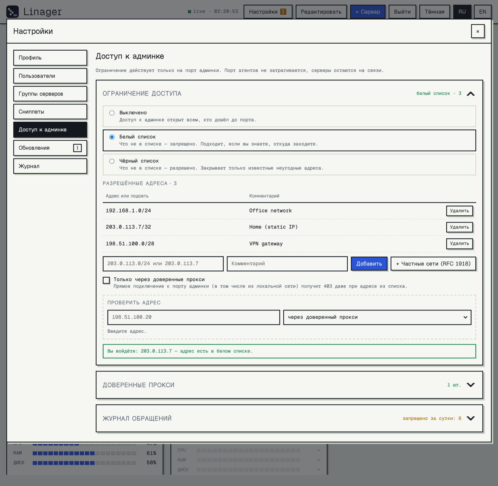
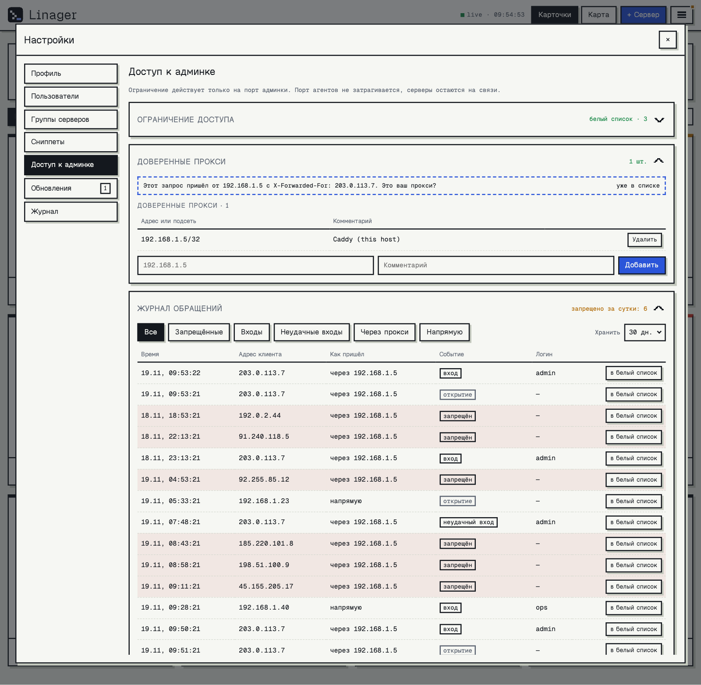

# Доступ к админке

«Настройки» → **Доступ к админке** ограничивает, кто может открыть админку, и показывает журнал обращений. Ограничение действует только на порт админки; порт агентов не затрагивается, серверы остаются на связи.



## Режимы

| Режим | Поведение |
|---|---|
| Выключено | Админка открыта всем, кто дошёл до порта. |
| Белый список | Чего нет в списке, то запрещено. Подходит, если вы знаете, откуда заходите. |
| Чёрный список | Чего нет в списке, то разрешено. Закрывает только известные неугодные адреса. |

У каждого режима свой список адресов и подсетей (`203.0.113.7` или `203.0.113.0/24`, IPv6 тоже) с комментарием. Кнопка «+ Частные сети (RFC 1918)» добавляет в белый список `10.0.0.0/8`, `172.16.0.0/12` и `192.168.0.0/16`. «Проверить адрес» показывает, что сервер сделает с адресом, пришедшим через доверенный прокси или напрямую.

## Доверенные прокси

За обратным прокси, например Nginx Proxy Manager, соединение приходит от прокси, а не от посетителя. Реальный адрес сервер берёт из `X-Forwarded-For` **только** если соединение пришло с доверенного прокси. Соединение с любого другого адреса оценивается по своему адресу, а заголовок игнорируется, поэтому подделать его нельзя, а из локальной сети можно заходить напрямую.

Если открыть раздел через прокси, он покажет, как пришёл запрос, и предложит «Добавить … как доверенный». Добавьте прокси и удалите значение по умолчанию `0.0.0.0/0` (доверие всем): пока доверие дано всем, списки включить нельзя.

::: warning Не оставляйте прокси недоверенным
Если прокси не доверенный, а в белом списке вся локальная сеть, каждый посетитель выглядит как прокси (локальный адрес), и интернет проходит. Админка предупреждает об этом и не даёт сохранить такие настройки.
:::

Переключатель **Только через доверенные прокси** закрывает прямые подключения к порту (в том числе из локальной сети), даже если адрес есть в списке.

Если Nginx Proxy Manager стоит за Cloudflare, включите в NPM передачу реального адреса посетителя, иначе вы увидите адрес Cloudflare. Если NPM работает в Docker на том же сервере, Linager может видеть его по адресу шлюза сети Docker (например `172.17.0.1`): добавьте именно тот адрес, который покажет интерфейс.

## Что нельзя сохранить

Админка проверяет каждую правку и не применяет её, если:

- она заблокирует вас самих (ваш адрес будет отклонён);
- доверие дано всем (`0.0.0.0/0`);
- прокси присылает `X-Forwarded-For`, но его нет в списке доверенных;
- белый список пуст.

Применение требует подтверждения и пишется в журнал аудита (`access.update`).

## Журнал обращений



В журнал попадают открытие страницы, входы (удачные и неудачные) и запрещённые запросы с адресом клиента и прокси, через который он пришёл. Фильтры: все, запрещённые, входы, неудачные входы, через прокси, напрямую. «В белый список» и «в чёрный список» добавляют адрес одним щелчком. Срок хранения: 7, 30 или 90 дней. Фоновые запросы интерфейса не пишутся.

## Если заблокировали себя

На сервере:

```bash
sudo linager access reset
```

Ограничение выключится, списки сохранятся. Работающий сервер применит это в течение нескольких секунд.
